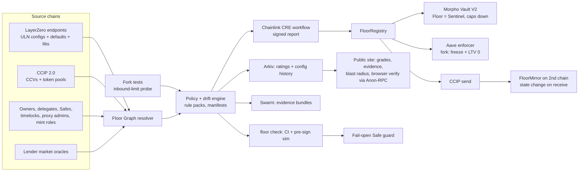

# 06 · Architecture

## Components

| Component | Tech (planned) | Notes |
|---|---|---|
| Resolver / collectors | TypeScript (viem) or Go; multi-chain RPC pool | Pin block per scan; retries; RPC diversity (never trust one provider: the Kelp lesson) |
| Policy engine | TypeScript, rule packs as versioned data | Rule ID + framework version in every result |
| Fork tests | Foundry (`forge`, `anvil`), pinned fork blocks | Inbound-limit probe, Kelp replay, guard tests |
| CRE workflow | Chainlink CRE SDK (TS/Go) | Simulation via `cre workflow simulate` is enough for the prize; deploy needs approval |
| Contracts | Solidity: `FloorRegistry`, `FloorMirror` (CCIP receiver), `FloorSentinel` (Morpho), Aave enforcer (fork), `FloorGuard` (fork) | Small, no admin keys where possible; invariant-tested |
| CCIP | Router + `ccipSend` / `_ccipReceive` | Must change state in our contract (prize rule) |
| Arkiv | Rabdi testnet, JS/TS SDK | Ratings + config-history entities; importer is re-runnable |
| Swarm | Postage batch + uploads | Evidence bundles; references stored in Arkiv |
| Frontend | Static site; reads via EF Anon-RPC by default | Works with our backend switched off |

## Enforcement points (and their honest limits)

| Point | What it catches | What it cannot catch |
|---|---|---|
| **CI / pre-sign check** | A planned `setConfig`/library/delegate change that lowers the floor, before anyone signs | Txs sent outside the pipeline (e.g. an EOA delegate) |
| **Safe guard (fail-open, post-state)** | Weakening via the Safe's own signed-tx path, incl. MultiSend, delegatecall tricks, fake-3 configs, `setDelegate` | Modules (Safe ≤1.4.1), EOA/timelock delegates, LayerZero default changes, other chains, a quorum that removes the guard first ([08](08-safe-guard-findings.md)) |
| **Continuous monitoring (source of truth)** | Everything above, plus LZ default changes, delegate/owner changes, modules, other chains | Nothing to block with; it alerts and feeds enforcers |
| **Lender enforcers** | New exposure against BREACHED collateral | Existing positions (by design: no forced unwinds) |

## Trust model

- Ratings are deterministic from public chain data at a pinned block; anyone can recompute.
- The browser verifier reads through EF Anon-RPC so no RPC provider can target it with tailored lies (the Kelp attack pattern was RPC poisoning aimed at one verifier).
- CRE adds a decentralised signature; CCIP carries status without trusting Floor servers.
- Floor's own keys: no upgrade keys on enforcers; Sentinel role can only *decrease* caps.

## Fallbacks

- If CRE deploy access isn't granted: CRE simulation (accepted for the prize) + Floor-signed reports, stated as such.
- If the chosen CCIP lane is pre-v2.0: claim "CCIP", not "CCIP 2.0", or switch to a v2.0 lane.
- If Aave fork wiring fails: guarded lending contract on the fork; Morpho Sentinel loop on mainnet remains the real-lender proof.
